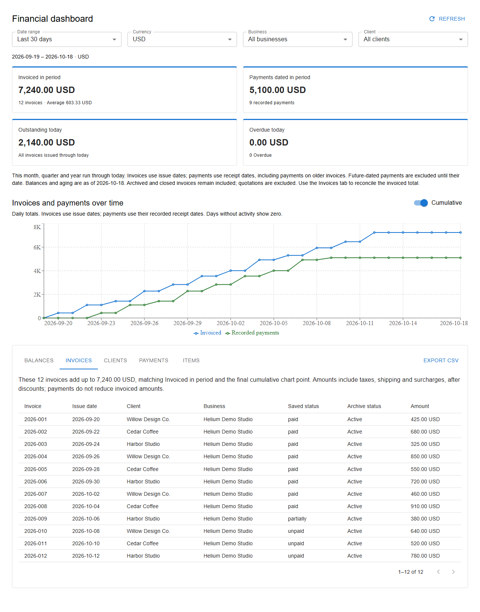
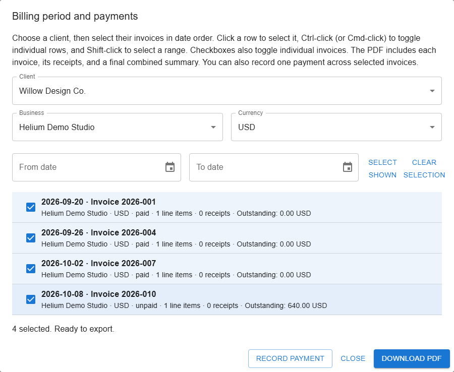

<p align="center">
  
</p>

<h1 align="center">Invoice Builder Helium</h1>

<p align="center">
  <strong>Your invoices. Your clients. Your data.</strong><br />
  A desktop workspace for invoices, quotes, billing periods, and payments.
</p>

<p align="center">
  <a href="INSTALL.md"><strong>Install Helium</strong></a> ·
  <a href="TUTORIAL.md">User guide</a> ·
  <a href="History.md">What's changed</a> ·
  <a href="https://github.com/djamondaxuzm/invoice-builder-Helium/issues">Report an issue</a>
</p>

<p align="center">
  <a href="INSTALL.md#build-a-windows-installer"></a>
  <a href="INSTALL.md#build-a-macos-installer"></a>
  <a href="LICENSE"></a>
</p>

Helium is **[djamondaxuzm's](https://github.com/djamondaxuzm) personal fork** of Invoice Builder, shaped around small-business billing: turn individual jobs into branded PDFs, combine a client's bills into a billing period, and see what has been invoiced and paid. Use a local SQLite database for offline work, with no hosted account required.

## Get started

**Start with the [installation guide](INSTALL.md).** It includes copy-and-paste build commands, the location of the finished installer, upgrade steps, and fixes for common packaging errors.

| Platform     | Install instructions                                     | Finished installer |
| ------------ | -------------------------------------------------------- | ------------------ |
| Windows, x64 | [Build on Windows](INSTALL.md#build-a-windows-installer) | Setup `.exe`       |
| macOS        | [Build on your Mac](INSTALL.md#build-a-macos-installer)  | `.dmg`             |

> **Download availability:** As of October 18, 2026, this fork has no published releases. Build from source using the guide above; future installers will appear under [Releases](https://github.com/djamondaxuzm/invoice-builder-Helium/releases). A `.yml`, `.yaml`, or `.blockmap` file is not an installer, and updating `main` does not publish a download automatically.

Already using Helium? [Back up your database and upgrade](INSTALL.md#updating-an-existing-installation).

## What you can do

| Workflow                        | What Helium provides                                                                                                                                                                    |
| ------------------------------- | --------------------------------------------------------------------------------------------------------------------------------------------------------------------------------------- |
| **Create invoices and quotes**  | Reusable businesses, clients, items, units, and currencies; discounts, taxes, shipping, and surcharges; PDF previews and export.                                                        |
| **Bill a client for a period**  | Choose a client, filter by business and currency, and select dated invoices with checkboxes, Ctrl/Cmd-click, or Shift-click. Export their invoices, receipts, and a combined summary.   |
| **Record payments**             | Capture amounts, actual dates, methods, and notes. Allocate one payment across multiple invoices with a per-invoice preview before saving.                                              |
| **Understand your finances**    | Filter by period, client, business, and currency. Compare invoiced amounts with dated payments, review outstanding balances and overdue aging, and export report tables to CSV.         |
| **Make PDFs your own**          | Company logos, style profiles, layouts, receipt attachments, and branded billing-period summaries. Logos retain their proportions; eligible large logos are optimized for smaller PDFs. |
| **Keep shared details current** | Update linked business/client details and catalog items across existing invoices and quotes. Archive catalog entries without removing their existing invoice lines.                     |
| **Keep control of your data**   | Local SQLite storage, database backups, JSON import/export, and spreadsheet exports. Existing PostgreSQL connections remain supported.                                                  |

## A clearer view of your billing

The financial dashboard separates **invoiced amounts**, **dated payments**, and **current balances**. The Invoices tab lists the documents behind the billed total, so you can reconcile the chart against individual invoices or export the table to CSV.



_Current reporting UI with fictional demo data. [Read the dashboard guide](TUTORIAL.md#financial-dashboard)._

<details>
<summary><strong>How report dates and totals work</strong></summary>

- Invoiced totals use **invoice issue dates**. Payments use their **actual recorded payment dates**, including payments for older invoices.
- **Last 30 days** includes today and the preceding 29 local dates. **This month**, **This quarter**, and **This year** run through today.
- Outstanding and overdue amounts are **balances as of today**, regardless of the selected chart period.
- Archived and closed invoices remain in reports. Quotes are excluded, and currencies are reported separately.
- Older invoices marked Paid without payment details remain settled. Helium does not invent payment dates or put undocumented amounts into the cash timeline. Use **Add missing payment details** when the real date and method are known.
- Future-dated payments are excluded from received cash until their date. The dashboard flags them so they are visible.

</details>

## From individual jobs to a billing period

1. Open **Invoices → Billing period / payments** and choose a client.
2. Select the business and currency, optionally narrow the date range, and choose the invoices in date order.
3. Select **Download PDF** to create the billing-period document, including receipts and a branded combined summary.
4. When payment arrives, select the relevant invoices and choose **Record payment**. Confirm the amount, date, method, and allocation before saving.



_Fictional demo data. [Billing-period guide](TUTORIAL.md#export-a-billing-period) · [Bulk-payment guide](TUTORIAL.md#one-payment-across-several-invoices)_

## Your first invoice

**Smaller receipt files:** New attachments are optimized before saving, and PDF exports also prepare smaller copies of older receipts. In an invoice's attachment section, **Reduce stored attachments** shows the savings; save the invoice to keep the smaller images. See [receipt storage and PDF size](TUTORIAL.md#receipt-storage-and-pdf-size) for quality settings and database behavior.

Create or open a database, check your business and payment details, add a client and catalog items, then create an invoice. Choose its date, line items, and style, save it, and export the PDF. The [user guide](TUTORIAL.md) covers each screen, including quotes, receipts, and customization.

**Shared catalog edits affect existing documents.** Changes to linked business/client definitions and catalog item names, units, or prices update existing invoices and quotes too. Archiving an item only removes it from normal catalog selection; existing invoice lines remain intact. Review the [update rules](TUTORIAL.md#invoice-save-and-date-behavior) before changing a shared definition.

## Guides and support

| Looking for…                                    | Go to…                                                                         |
| ----------------------------------------------- | ------------------------------------------------------------------------------ |
| Installation, updates, or a locked build folder | [Installation & troubleshooting](INSTALL.md)                                   |
| Everyday invoice and payment workflows          | [User guide](TUTORIAL.md)                                                      |
| PDF layout customization                        | [Layout reference](LAYOUT.md)                                                  |
| Recent fixes and features                       | [Changelog](History.md)                                                        |
| A bug report or feature request                 | [GitHub Issues](https://github.com/djamondaxuzm/invoice-builder-Helium/issues) |
| Data handling and terms                         | [Privacy policy](PRIVACY-POLICY.md) · [Terms of use](TERMS-OF-USE.md)          |

For a bug report, include the app version, Windows/macOS version, steps to reproduce, and expected versus actual behavior. Use a fictional example or redact client details from screenshots and logs.

## Development

Helium uses Electron, React, TypeScript, and Vite. The desktop targets are **Windows and macOS**. See [CONTRIBUTING.md](CONTRIBUTING.md) for contribution guidelines.

With Git and Node.js/npm installed (CI uses Node.js 22):

```bash
git clone https://github.com/djamondaxuzm/invoice-builder-Helium.git
cd invoice-builder-Helium
npm ci
npm run dev
```

<details>
<summary><strong>Verification commands and source map</strong></summary>

Run these from the repository root:

```bash
npm test -- --run --maxWorkers=1
npm run lint
npx tsc --noEmit -p tsconfig.app.json
npm run build
```

For the reporting and payment browser tests, install Playwright's Chromium browser with `npx playwright install chromium`, start Vite with `npm run dev:react -- --port 5185`, then run `npx playwright test --config=playwright.reports.config.ts` in a second terminal.

| Source               | Responsibility                                |
| -------------------- | --------------------------------------------- |
| `src/renderer`       | Screens, PDF rendering, state, and UI helpers |
| `src/backend/main`   | Electron desktop application                  |
| `src/backend/shared` | Database access, migrations, and shared logic |
| `src/preload`        | Desktop bridge between the UI and backend     |
| `e2e`                | Browser workflow tests and demo fixtures      |

The internal HTTP adapter is retained for compatibility checks and excluded from desktop packaging. Linux and Docker distributions are not supported by this fork. See the [compatibility notes](TUTORIAL.md#database-and-platform-compatibility) for retained database support.

</details>

## License

[MIT](LICENSE). Maintained by [djamondaxuzm](https://github.com/djamondaxuzm); original copyright and license notices are preserved.
